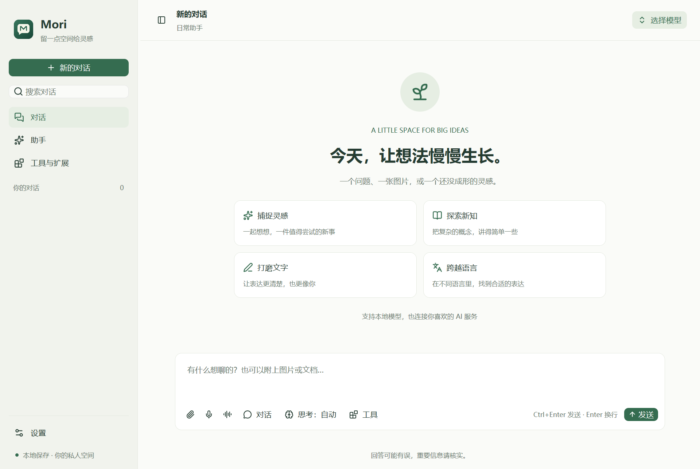

# Mori

一个用 Rust 和 **gpui-kit 0.7.3** 编写的原生 AI 聊天客户端。暖白与墨绿的界面，以日常对话、图片、资料和个人助手为中心。

项目目录与 Cargo 包名为 `mori-ui`，界面品牌统一为 **Mori**。图标源文件是 `assets/mori.svg`，PNG 和多尺寸 Windows ICO 由 `scripts/build-icons.cjs` 生成（需要 Node.js 与 `sharp`）。图标内嵌到程序，不依赖运行目录；Windows 构建需要 SDK 的 `rc.exe` 或 MinGW 的 `windres`。现有会话数据目录和系统密钥标识保持兼容。



## 运行

需要 Rust 稳定版与对应平台的原生构建工具。当前已在 Windows / Rust 1.99 上构建并验证。

```powershell
cargo run
```

编译后的 Windows 应用是 `target/debug/mori.exe`。发布构建使用 `cargo build --release`，产物在 `target/release/mori.exe`。如果旧应用仍在运行，先关闭旧窗口以保存会话，再启动新版。

第一次使用：打开左下角「设置」，选择服务商，填写 API 地址和密钥，点击「连接并获取模型」。本地 Ollama 的默认地址是 `http://localhost:11434`，不需要密钥。点击聊天页右上角的模型选择器开始使用。预设模型是便于开始的示例，模型发现和手动填写支持服务商实际提供的模型。

Ollama 原生协议填写服务器根地址（例如 `http://localhost:11434`）；尾部 `/v1` 或 `/api` 会自动规范化，兼容旧配置。若要使用 Ollama 的 OpenAI 兼容接口，选择 OpenAI 协议并保留 `/v1`。保存配置不代表服务器连接已验证，请使用「连接并获取模型」测试。

## 已实现

- **多服务商**：Ollama 原生协议、OpenAI Chat Completions 协议、Anthropic Messages 协议。预置 OpenAI、Claude、Gemini、DeepSeek、Qwen、SiliconFlow、OpenRouter、Groq、LM Studio；可添加自定义兼容接口。
- **聊天**：流式响应、Markdown、代码块、表格、可选择文本、思考过程折叠、回复耗时与输出 token 数、停止、重试、复制和朗读。
- **数学公式**：正文和思考过程支持 `$…$` 行内公式、`$$…$$` 独立公式、`\(...\)` / `\[...\]`。本地 RaTeX 排版支持常见分数、上下标、根号、希腊字母、矩阵与中文标注，随主题调整颜色。代码块保持原样，未闭合或解析失败时保留源码；会话保存、复制消息与导出仍保留原始 LaTeX。
- **会话管理**：搜索标题和正文、置顶、列表直接重命名和删除、撤销最近一次删除、草稿自动保存、编辑消息时保留原会话并创建分支、从任意回复分支、JSON 导入与 Markdown / JSON 导出。
- **多模态**：选择或拖入图片、UTF-8 文档和 PDF；图片消息预览。Ollama 接收图片与 PDF 提取的文字，云端支持原生图片 / PDF 内容块。单个附件最多 20 MB。
- **图片与语音**：通过支持相应接口的 OpenAI 兼容服务生成图片、朗读消息、导入音频转写，以及麦克风录音转写。转写先放入输入框，发送由用户决定。
- **助手**：预设日常、写作、学习和翻译伙伴，自定义名称与系统提示词。
- **工具**：Function call、自定义函数程序、MCP stdio / Streamable HTTP、Bash。逐次展示工具参数，由用户允许或拒绝，然后把结果交回模型继续对话。
- **外观**：完整 SVG 图标资源、同步的绿色主题颜色、浅色 / 深色外观、统一卡片宽度与间距、小窗口布局。

## 本地数据与密钥

会话库与附件位于操作系统的应用数据目录。在 Windows 上通常为 `%LOCALAPPDATA%/mori/Mori/data`；以设置中的「打开数据目录」为准。`library.json` 通过临时文件替换保存，保留上一版 `library.backup.json`。加载损坏的会话库时禁用覆盖保存，原文件保留。

API Key 保存到系统凭据库，不写入会话 JSON。可用服务商 ID 对应的环境变量覆盖，例如 `OPENAI_API_KEY`、`ANTHROPIC_API_KEY`、`DEEPSEEK_API_KEY`、`QWEN_API_KEY`、`SILICONFLOW_API_KEY`、`OPENROUTER_API_KEY`。自定义服务商以设置中的内部 UUID 为 ID。

`MORI_DATA_DIR` 可以指定独立的数据目录，适合测试。JSON 导出包含配置与会话，但图片等二进制附件仍通过本地路径引用；完整迁移应同时复制数据目录。MCP 自定义环境变量保存在本地配置，导出时也会包含它们，因此不建议在其中放入长期凭据。

## 工具和 MCP

在「工具与扩展」里填写 MCP 的名字，以及远程地址或本地程序和启动参数。保存后开启工具，发送聊天消息时会初始化连接并发现工具。服务器认证可以通过本地进程的环境变量配置；HTTP OAuth、旧版 HTTP+SSE、MCP sampling / elicitation 尚未实现。

「高级设置与自定义函数」允许配置更细的选项。例如：

```json
{
  "tools_enabled": true,
  "bash_enabled": false,
  "mcp": [
    {
      "name": "资料库",
      "command": "npx.cmd",
      "args": ["-y", "@modelcontextprotocol/server-filesystem", "C:/Users/Public/Documents"],
      "env": {},
      "url": "",
      "enabled": true
    }
  ],
  "functions": []
}
```

未填写的设置使用默认值。自定义函数的结构为 `name`、`description`、`parameters`（JSON Schema）、`command`、`args`、`enabled`。参数 JSON 通过 stdin 交给指定程序，stdout / stderr 返回模型。Bash 和函数程序不在沙箱中运行；实际执行前会显示参数并请求确认。每次生成最多 12 轮工具调用，函数 / Bash 单次执行最多 60 秒。

## 能力范围

图片、PDF、工具、图像生成和音频接口取决于所选服务商与模型。OpenAI 兼容服务商不一定提供图像和音频接口。音频输入是录音后转写，不是 Realtime 全双工语音；本地 PDF 文本提取不执行 OCR。当前没有实现账户云同步、向量知识库、原生网页搜索或 Responses API；可以通过 MCP 接入搜索与资料服务。

停止按钮会立即结束界面接收并保留当前回复。阻塞 HTTP 连接会在下一段响应到来或超时后释放，未实现服务商后台任务的远程取消。当前一次运行一个生成请求，支持生成中查看其他会话。

## 验证

当前验收结论与正式发行前的缺口见 [ACCEPTANCE.md](ACCEPTANCE.md)。GitHub Actions 在推送与 PR 时执行 Windows 构建、测试和代码检查。

```powershell
cargo test
cargo clippy --all-targets --features visual-test -- -D warnings
cargo fmt --check
```

测试使用本地 HTTP 模拟服务，覆盖三种服务商协议的完整流式请求、跨网络块的 UTF-8 / SSE、工具拒绝后的继续回复、异常断流、MCP 初始化 / 工具发现 / 执行 / 会话头、本地保存与备份。不会调用真实付费服务。

界面验证使用 GPUI 自身的 `render_to_image`，不是网页仿制效果图。运行下列命令将输出 15 个实际界面状态，并自动检查重命名、删除、恢复、保存服务商提示和地址规范化，以及浅色 / 深色 / 小窗口数学公式：

```powershell
$env:MORI_DATA_DIR = "$PWD/.mori-visual"
$env:MORI_SNAPSHOT_DIR = "$PWD/artifacts/screenshots"
cargo run --features visual-test
Remove-Item Env:MORI_DATA_DIR
Remove-Item Env:MORI_SNAPSHOT_DIR
```

截图模式不保存模拟会话，不发起模型请求，不开启麦克风，同时检查后台附件导入切换会话时的归属。

## 代码结构

- `src/ui/`：原生页面、统一视觉样式、设置和渲染检查。
- `src/ui.rs`：会话操作、草稿、异步任务、工具确认、附件与音频交互。
- `src/provider.rs`：请求转换、流式解析、工具对话循环、图片与音频 API。
- `src/tools.rs`：MCP 传输、工具注册、受用户确认的程序执行。
- `src/storage.rs`：会话保存、附件、PDF 文本提取与系统密钥。
- `src/audio.rs`：原生麦克风录音。
- `src/model.rs`：可序列化的数据模型。

框架：[GPUI Kit](https://github.com/longbridge/gpui-kit)。接口遵循 [Ollama](https://docs.ollama.com/api/chat)、[OpenAI](https://developers.openai.com/api/reference/resources/chat)、[Anthropic](https://platform.claude.com/docs/en/api/messages) 和 [MCP](https://modelcontextprotocol.io/specification/2025-06-18/basic/transports) 文档。
